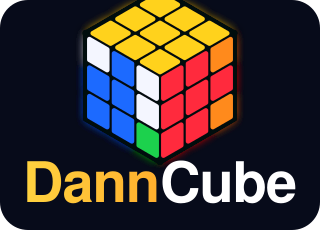

# DannCube · CFOP 3x3 Guide

A website for learning the CFOP method on the 3x3 cube, in English and Lao (ລາວ).

**Created by Sinthanavanh Sinsamphanh.**

**Live site:** https://dan16ssd.github.io/cfop-3x3-guide/

## What's inside

- **3D playground**: an animated three.js cube. Type an algorithm, tap moves, or load any case and step through it.
- **Cross and F2L**: tips plus 12 intuitive F2L cases.
- **Advanced F2L**: all 41 F2L cases for every slot (FR, FL, BR, BL) with rotation-free algorithms, plus X-cross, XX-cross, keyhole, multi-slotting, pseudo-slotting and edge control.
- **CFOP solver**: paste a scramble and get a fast CFOP solution. It tries cross, X-cross and XX-cross starts, solves pairs with optimal F2L, uses edge control on the last pair, then finishes with ZBLL or OLL + PLL.
- **X-cross trainer**: practice cross, X-cross, XX-cross (any slot or pair, including diagonal FL + BR) and last-slot edge control with a 15 s inspection timer, answer checking against the optimal solution, and stats.
- **Scrambles**: every algorithm card shows a scramble that sets up that case.
- **Last layer**: 2-look OLL/PLL, full OLL (57), full PLL (21), COLL (42), full ZBLL (493).
- **Finger tricks tutorial**: diagrams showing hand and finger positions for each move.
- **Drills**: 16 drills (sexy move, sledgehammer, anti-sledge, ...) with fingering labels and a drill timer.
- **Training**: a routine adapted from Yiheng Wang's documented habits, a weekly plan, a roadmap from sub-2:00 to sub-8.
- **Timer**: WCA-style random scrambles with ao5/ao12.

Every algorithm is checked by the built-in cube simulator (`js/app.js`): it must keep the first two layers intact and solve exactly the case drawn in its diagram.
COLL and ZBLL algorithms were generated by search over verified building blocks and R/U/F/D move sequences.

## Files

- `index.html`: page structure
- `css/style.css`: styles (light and dark theme)
- `js/app.js`: cube model, diagrams, algorithm data, playground, timer, drills
- `js/cube3d.js`: three.js 3D cube renderer
- `js/zbll-data.js`: the 493 ZBLL algorithms
- `js/f2l-data.js`: the 164 advanced F2L algorithms (41 per slot)
- `js/solver.js`: the CFOP F2L solver (runs in a Web Worker)
- `js/i18n.js`: Lao and English text

No build step. Open `index.html` or serve the folder.

## License

© 2026 Sinthanavanh Sinsamphanh. All rights reserved.
This is **not** open source. You may not copy, modify, redistribute or use any part of this project without written permission. See [LICENSE](LICENSE).
